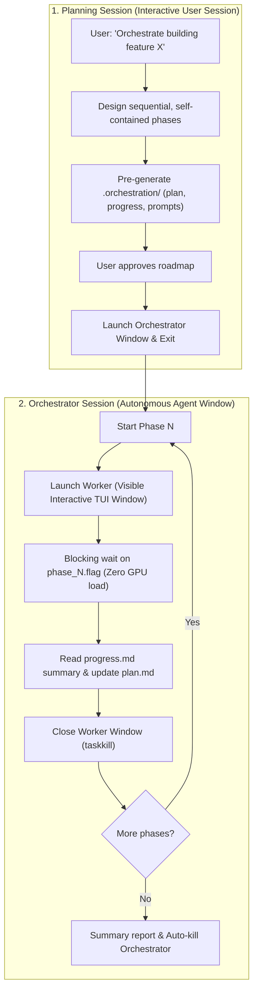

# 🎭 pi-orchestrator

> **Orchestrate software projects of arbitrary size and duration with the [`pi` CLI](https://github.com/michaellperry/pi) — featuring fresh-context workers, live visual TUI execution, and zero local GPU contention.**

[](https://microsoft.com)
[](https://github.com/michaellperry/pi)
[](#zero-gpu-contention-guarantee)
[](LICENSE)

---

## 💡 What is `pi-orchestrator`?

**`pi-orchestrator` is an agent skill that allows you to hand off massive coding projects to the [`pi` CLI](https://github.com/michaellperry/pi) and let it work completely autonomously across sequential phases.**

Instead of you sitting at your terminal manually opening sessions, copying prompts, and watching an agent degrade after an hour of work:
1. **You define the goal:** (e.g., *"Build an entire full-stack application with authentication, database migrations, REST endpoints, and integration tests"*).
2. **The agent designs the plan:** It breaks the work down into atomic, testable phases and writes self-contained prompts for each phase in `<project>/.orchestration/`.
3. **The orchestrator takes over:** A dedicated orchestrator window opens and executes the whole pipeline autonomously. It spawns each worker in its own **visible PowerShell TUI window**, waits for it to finish, verifies the deliverable, closes the window, and launches the next phase.
4. **You can close your initial chat:** Once the orchestrator is launched, your interactive session is done. You can watch the workers code live on your screen or walk away.

---

## 🚀 Build Projects as Long as You Want (No Context Limits)

The biggest barrier to building complex software with AI agents is **context exhaustion**:
* Even when modern models support **130k–150k tokens**, running large projects in a single continuous session inevitably causes performance to collapse.
* As token counts climb, models lose needle-in-a-haystack precision, begin repeating bugs, hallucinate files, and trigger **painfully slow context compaction loops**.
* After a few hours, a single-session agent inevitably derails or corrupts the codebase.

### 🔥 How `pi-orchestrator` solves this permanently:
Your project can require **5 phases, 25 phases, or 100 phases spanning multiple days**. There is **no upper limit on project complexity**:

* **Clean-Slate Context for Every Phase:** Each phase runs in a brand new, isolated `pi` process. A worker starts with a **100% fresh context window** (~0 tokens) and reads only what it needs (`plan.md` + the latest entry of `progress.md`).
* **Zero Cumulative Degradation:** Phase 20 runs with the exact same speed, precision, and adherence to instructions as Phase 1.
* **Compaction-Free Execution:** Each phase is sized with safety margins so workers finish their tasks cleanly **without ever needing to compact context**.

### 💡 The 50% Safety Margin Rule (Context Sizing Recommendation)

> [!TIP]
> **Why this skill targets ~65k–70k tokens even on 130k–150k models:**
> When planning agents estimate tasks, they consistently underestimate the real token footprint of execution (assumes a factor of ~2x for reasoning, retries, and verbose command outputs).
> 
> * **The Golden Rule:** Always cap phase estimates to roughly **50% of your model's real context limit** (e.g. **~65k–70k tokens** for a 130k–150k model).
> * **The Result:** The worker works comfortably with generous headroom, executes builds and tests, and finishes cleanly **without ever triggering compaction**.
> * **Using other models?** If your model has a 64k, 200k, or larger context window, adjust the target limit proportionally in `SKILL.md` (or simply prompt your agent: *"My model supports Xk context, plan phases keeping a 50% safety margin"*).

---

## ⚡ Architecture Flow



---

## 🏆 Key Advantages

| Advantage | Why It Matters |
|---|---|
| ♾️ **Infinite Project Horizon** | Slices monolithic work into small, verified deliverables. Your agent can build entire full-stack apps over dozens of phases without getting confused. |
| 🪟 **Live Interactive TUI Visibility** | Workers do **not** run as silent background processes. Each worker opens in a **visible interactive PowerShell window** (`pi -a "@prompt"`). You see live token streaming, tool calls, bash outputs, and errors in real time. |
| 🧠 **Zero Local GPU Contention** | While a worker runs local inference on your GPU, the orchestrator sits idle in a non-reasoning blocking wait script (`wait-flag.ps1`). **Zero concurrent inference fighting for local VRAM.** |
| 🛡️ **Fail-Safe & Idempotent** | Completion is determined by a physical file on disk (`phase_N.flag`), not process heuristics. If a phase fails or blocks, it can be retried immediately (e.g. `-Tag "3_r2"`). |
| 🧼 **Zero Pollution of Project Root** | All orchestration files, logs, wrappers, and flags live strictly inside `<project>/.orchestration/`. |

---

## 📂 Project Structure During Orchestration

When an orchestration begins in a target project, `pi-orchestrator` generates:

```
<project>/.orchestration/
├── plan.md                 # Master plan: phases 1..N, checklist, global decisions
├── progress.md             # Continuous log written strictly by workers
├── orchestrator.md         # Master prompt driving the orchestrator session
├── prompts/
│   ├── phase_1.md          # Complete, self-contained prompt for worker 1
│   ├── phase_2.md          # Complete, self-contained prompt for worker 2
│   └── ...
└── state/
    ├── phase_N.flag        # Completion flag (worker's absolute last action)
    ├── phase_N.pid         # Window PID (recorded by launch-worker.ps1)
    ├── worker_N.ps1        # Execution wrapper generated by launch-worker.ps1
    ├── orchestrator.pid    # Orchestrator window PID
    └── orchestrator.ps1    # Orchestrator startup wrapper
```

---

## 🚀 Getting Started

### Prerequisites

* **Operating System:** Windows 10 / 11 with PowerShell 5.1+ or PowerShell 7+.
* **CLI:** [`pi`](https://github.com/michaellperry/pi) installed and available on your system `PATH`.
* An agent environment supporting skills (such as Antigravity, Claude Code, or custom skill loaders).

### Installation

Clone this repository into your agent skills directory:

```bash
git clone https://github.com/<your-username>/pi-local-orchestrator.git pi-orchestrator
```

---

## 🛠️ Typical Usage Walkthrough

### 1. Trigger the Skill
In your interactive agent session, ask:
> *"Create a plan to build a full REST API with auth, database migrations, and integration tests, and orchestrate it."*

### 2. Review and Confirm
The planning agent will:
1. Divide the project into small, verifiable phases (e.g., 6 phases, each with a testable deliverable).
2. Write `.orchestration/plan.md`, `progress.md`, and all `prompts/phase_N.md`.
3. Show you the summary and wait for your explicit confirmation.

### 3. Hands-Off Orchestration
Once confirmed:
* A new PowerShell window pops up: **The Orchestrator**.
* You can close your original planning chat! The orchestrator now drives the pipeline.
* For each phase, a **Worker window** pops up, runs its prompt live in front of you, writes its deliverable, posts its summary to `progress.md`, drops its `.flag`, and gets closed cleanly.
* When phase $N$ completes, the orchestrator prints the final summary and closes itself.

---

## ⚙️ Included Automation Scripts

All scripts are located in [`scripts/`](scripts/) and run via PowerShell:

| Script | Purpose |
|---|---|
| [`launch-orchestrator.ps1`](scripts/launch-orchestrator.ps1) | Spawns visible window running `pi -a "@orchestrator.md"` in `$ProjectDir`. Saves PID to `orchestrator.pid`. |
| [`launch-worker.ps1`](scripts/launch-worker.ps1) | Spawns visible window running `pi -a "@prompts/phase_N.md"` in `$ProjectDir`. |
| [`wait-flag.ps1`](scripts/wait-flag.ps1) | Blocking wait loop for `state/phase_N.flag` (default 60 min timeout). |
| [`kill-worker.ps1`](scripts/kill-worker.ps1) | Kills the worker process tree via `taskkill /PID ... /T /F`. |
| [`kill-orchestrator.ps1`](scripts/kill-orchestrator.ps1) | Kills the orchestrator process tree as its own final action. |

---

## 🛡️ The Golden Rule of Workers: The Flag Contract

To ensure that the orchestrator and worker never compete for GPU VRAM:
1. The worker performs **all work, builds, tests, and writes to `progress.md` first**.
2. As its **absolute final action**, the worker writes `state/phase_N.flag`.
3. After creating the flag file, the worker performs **zero additional inference turns**. The orchestrator immediately wakes up, harvests the results, and cleanly closes the worker window.

---

## 📄 License

This project is licensed under the [MIT License](LICENSE).
